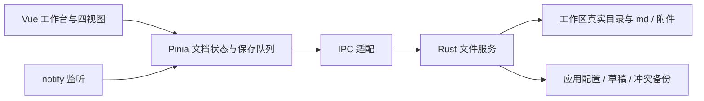

# MarkFlow 技术开发说明书

版本：0.1.0 · 更新日期：2026-10-02 · 阶段：首版实现

本文描述当前代码，不再是实施前候选方案。需求编号见 [项目说明书](project-guide.md)，测试结果和平台限制见 [验证记录](verification.md)，环境与启动命令见 [README](../README.md)。

## 1. 技术栈与模块

| 层 | 当前实现 | 作用 |
| --- | --- | --- |
| 桌面 | Tauri 2、Rust | 原生窗口、目录 / 保存对话框、文件读写、回收站、单实例 |
| 界面 | Vue 3、TypeScript、Vite | 桌面工作台、组件及构建 |
| 样式 | Tailwind CSS 4、shadcn-vue / Reka UI | 主题变量、按钮、设置字段、菜单、对话框 |
| 状态 | Pinia | 文档身份、编辑版本、保存状态、标签、工作区、设置 |
| 所见即所得 | Vditor 4 的即时渲染 IR | Markdown 输入与正文排版编辑 |
| 源码 | 原生 textarea | Markdown 原文、原生编辑历史与组合输入 |
| 预览 / 大纲 | markdown-it、任务列表插件、DOMPurify | CommonMark / GFM 渲染、安全过滤、标题位置 |
| 文件能力 | tempfile、SHA-256、notify、trash | 原子替换、冲突检测、外部监听、系统回收站 |
| 附件路径分析 | pulldown-cmark、pathdiff | 按语法位置修正移动文档的托管图片引用 |
| 验证 | Vitest、Rust 单元测试、Playwright + Edge / WebView2 | 保存协调、文件保护、界面与真实桌面流程 |

具体版本由 `pnpm-lock.yaml` 和 `src-tauri/Cargo.lock` 锁定。TypeScript 当前固定在兼容 vue-tsc 的 6.x。



浏览器开发预览使用明确标记的内存示例数据。`isTauri()` 为真时全部文件命令调用 Rust，浏览器示例不替代桌面文件服务。

## 2. 当前目录职责

```text
src/
  App.vue                      工作台、标签、视图切换、弹窗、快捷键、退出处理
  main.ts                      Vue 与 Pinia 初始化
  types.ts                     文档、工作区、设置、恢复条目类型
  styles.css                   主题与工作台布局
  components/
    EditorPane.vue             编辑器适配、图片与标题定位
    TreeNode.vue               递归目录与菜单
    SettingsDialog.vue         外观及编辑设置
    ui/                        shadcn-vue 组件源码
  stores/workbench.ts          读取、编辑、保存协调、冲突、草稿与会话
  services/api.ts              Tauri IPC / 浏览器示例适配
  services/markdown.ts         Markdown 渲染、安全过滤与标题位置
src-tauri/
  src/lib.rs                   原生命令与应用状态
  src/files.rs                 路径校验、UTF-8 编解码、原子保存与哈希
  capabilities/main.json       主窗口能力
  tauri.conf.json              窗口、CSP、构建与平台安装包配置
scripts/
  editor-assets.mjs            将 Vditor dist 复制到本地 public/vendor
  verify-ui.mjs                Edge 浏览器 UI 验证
  verify-native.mjs            隔离目录中的真实 Windows 原生验证
tests/workbench.test.ts        保存并发、失败、冲突与恢复测试
.github/workflows/build.yml    双平台检查及安装包构建流程
```

生成资源、构建缓存、测试夹具及安装包均由 `.gitignore` 排除。编辑器静态资源在安装依赖后准备，生产构建时再次准备，避免依赖安装脚本被跳过导致离线编辑器缺失。

## 3. 文档与四视图

文档模型保存 `id`、`workspaceId`、工作区相对 `path`、`text`、磁盘 `hash`、BOM / 换行标记、`revision`、`savedRevision`、`view`、`status`、`error` 和内容重新加载的 `generation`。

四视图共享 `text`；状态不以活动标签作为提交目标。各文档组件保持挂载、隐藏非活动页面，保留独立内核实例。源码与分屏共用同一个 textarea，预览与分屏共用同一份解析输出。

| 产品视图 | 当前映射 | 编辑 |
| --- | --- | --- |
| 所见即所得 | Vditor IR，输入 Markdown 标记即时排版 | 正文 |
| 源码 | textarea | 原文 |
| 分屏 | textarea + markdown-it 预览 | 左侧原文 |
| 预览 | 安全过滤后的 HTML | 只读 |

视图切换先同步即时编辑内容，再更新视图。仅初始化或切换视图时不向模型发送 Vditor 自动规范化的文本；使用初始序列化基线识别真正编辑。实际编辑后 Vditor 可能规范化列表、空格、链接等写法，源码视图用于保留原始格式。

本地图片以受控的 data URI 显示，URI 与源相对路径建立反向映射，提交 Markdown 时恢复原相对路径；同字节不同路径的图片有独立标识。缺失或禁止自动加载的图片使用占位显示，原始引用保留。

渲染依赖完全来自随应用打包的资源。公式、图表与远程上传未启用，代码块显示为代码，没有依赖外部高亮服务。Vditor 的能力与选项参考 [官方仓库](https://github.com/Vanessa219/vditor)。

## 4. Markdown 与安全渲染

支持 ATX / Setext 标题、段落与换行、分隔线、强调、粗体、行内代码、转义、实体、有序 / 无序 / 嵌套列表、引用、缩进 / 围栏代码块、行内 / 引用式链接与图片、自动链接，以及 GFM 表格、任务列表和删除线。

预览与大纲由 markdown-it 解析，标题使用解析 token 的行位置定位；代码围栏中的伪标题不会被正则误识别。重复标题通过 `heading-N` 独立定位。所见即所得标题定位到内核中的对应标题，源码定位选择位置并滚动，分屏同时定位两侧。

DOMPurify 删除脚本、事件处理器、iframe、嵌入对象、表单、任意样式等。原始 HTML 源文保留，显示结果执行安全过滤。任务复选框在预览中禁用。HTML 图片先移除直接资源地址，统一经受控解析；文档链接仅允许用户点击后打开 HTTP(S) 网页或工作区内的 `.md`。

CSP 限制脚本及资源为本地来源，图片仅允许本地、data / blob；不自动加载远程图片。Rust 相对资源解析限制在当前注册工作区内，阻止绝对路径、上级越界和特殊目录。

当前验证覆盖常见语法和安全样例，尚未运行全部 CommonMark / GFM 官方规范语料；两个渲染内核在复杂 HTML 或扩展语法下可能有显示差异。规范参考 [CommonMark](https://spec.commonmark.org/) 与 [GFM](https://github.github.com/gfm/)。

## 5. 保存与恢复

输入改变正文后递增 `revision`，500ms 防抖保存，连续输入时最多约 2s 提交一次。每个文档只有一个进行中的提交任务；提交捕获文档 ID、正文、编辑版本和磁盘基准哈希。

保存成功只确认该快照的 `savedRevision`。期间出现新输入时继续提交最新快照，不能提前显示所有输入已保存。Rust 应用状态互斥保护命令，正文写入前再次检查磁盘 SHA-256。内容经同目录临时文件、刷新和替换完成写入。

状态包括 `clean`、`dirty`、`saving`、`error`、`conflict`、`missing`。权限或 I/O 失败保留缓冲并可重试；冲突 / 文件缺失暂停自动保存。

| 情况 | 当前处理 |
| --- | --- |
| 外部修改，无本地未保存内容 | 重新读取磁盘内容 |
| 外部修改，同时有本地修改 | 暂停自动保存，可另存副本、重新加载或备份后覆盖 |
| 覆盖确认期间再次外部修改 | 拒绝本次覆盖，重新确认 |
| 外部删除 | 保留正文与草稿，不自动重建文件，提供另存副本 |
| 保存失败后关闭标签 | 保留标签；确认放弃后才关闭 |
| 保存失败后退出 | 取消退出，或所有当前草稿成功持久化后退出 |
| 异常退出 | 下次启动可恢复最近已成功落盘的草稿 |
| 原文件 / 工作区已失效的恢复草稿 | 打开源码恢复缓冲，标记不可保存，提供另存副本 |

草稿约在输入后 200ms 写入应用恢复目录，以工作区 ID 与路径的 SHA-256 为身份。保存仅删除内容与已保存快照相同的草稿，避免删除较新的恢复内容。恢复区写入失败显示错误。

冲突覆盖先把当前磁盘字节保存到应用 `backups/`，再检查确认版本并写入。另存副本通过原生保存对话框选择位置，源文件与原标签保存状态保持原义。

文档只支持 UTF-8；打开时识别 BOM 与 CRLF，编辑模型使用 LF，写回时保留原风格。读写单文档限 20MiB。混合换行会按识别到的风格统一；不承诺完整保留 Windows ACL、创建时间等所有文件元数据。

## 6. 工作区与文件操作

添加工作区使用原生目录选择器，记录真实 canonical 路径。同一根路径不重复添加，首版拒绝父子包含的重叠工作区。树按需列出目录及大小写不敏感的 `.md` 文件，目录在前，名称按小写排序。

路径检查逐段拒绝符号链接和 Windows reparse 目录，再确认 canonical 路径属于根目录。新建名称兼顾 Windows 保留名称、非法字符、末尾点 / 空格和 200 字符限制；目标重名不覆盖。新建文档界面自动补齐 `.md`。

重命名与移动先完成当前工作区的待保存内容，只能在同一工作区内进行。文件夹后代的活动文档路径一起更新。对移动涉及的 Markdown 使用语法事件与位置范围分析，修正指向根目录 `assets/` 的图片引用，保留原编码 / 换行。

移动记录操作日志和受影响正文的原字节；失败时尝试回滚。部分失败或进程中断后的恢复材料保留在 `operations/`，启动时提示检查。首版尚无自动事务恢复界面。

删除使用系统回收站 / 废纸篓，不退化为永久删除。移除工作区只移除注册入口。`notify` 提供外部变化通知，350ms 合并刷新；另每 5s 在可见窗口中校验磁盘状态。

文件系统与不协作的外部进程之间不具备完整跨进程事务锁，哈希检查缩小覆盖窗口但不消除所有检查 / 替换竞争；后续可针对各平台加强。移动也不承诺修复整个工作区的所有相对或入站链接。

## 7. 图片附件

粘贴与拖入捕获 File 数据，经 Rust 校验文件头和 20MiB 限制，支持 PNG、JPEG、GIF、WebP。成功写入工作区根目录 `assets/` 的唯一文件名后，编辑器才插入链接。

相对路径以文档所在目录为基准。例如 `技术/Vue.md` 使用 `../assets/uuid.png`。读取图片亦限定工作区路径并校验类型；前端显示 data URI，保存时恢复相对引用。附件不存入正文配置，不进行远程上传。

## 8. IPC 命令

参数遵循前端 camelCase；错误为 `{ code, message }`。文件身份由已注册工作区 ID 和相对路径，或已打开文档 ID 指定。

| 命令 | 用途 |
| --- | --- |
| `bootstrap` | 读取工作区、设置、恢复草稿与未完成操作数 |
| `select_workspace` / `remove_workspace` | 原生选择并注册 / 移除工作区 |
| `list_directory` | 列出受控目录 |
| `open_document` / `check_document` / `close_document` | 打开正文、读取磁盘哈希、释放文档身份 |
| `save_document` | 带 expectedHash / revision 的保存，可请求冲突备份 |
| `write_recovery` / `discard_recovery` / `open_recovery` | 恢复快照写入、删除、打开缺失原文件的缓冲 |
| `save_preferences` | 原子写入设置与会话，限制 128KiB |
| `create_entry` / `relocate_entry` / `trash_entry` | 文件与目录操作 |
| `import_image` / `resolve_image` | 附件导入与受控图片读取 |
| `resolve_markdown_link` | 定位工作区内 Markdown 链接 |
| `save_document_as` | 原生对话框另存副本 |

前端 capability 仅启用主窗口基础能力、窗口退出和系统浏览器打开，不授予前端通用磁盘插件权限。原生目录 / 保存对话框从 Rust 调用。Tauri capability 与 CSP 配置参考 [官方配置](https://v2.tauri.app/reference/config/)。

## 9. 设置与数据目录

设置分为“外观”和“文档设置”，包含显示模式、主题色、正文 / 代码字体及 10–36px 字号、默认视图、大纲 / 左栏显示和宽度，以及标准 / 超宽文档显示样式。标准模式正文居中，约 760px；超宽模式铺满可用内容区，仅保留必要边距。四种视图均生效，默认标准模式；旧配置缺失或包含非法显示样式时回退标准。更改立即反映到 CSS 变量及编辑器主题，200ms 合并持久化，正常退出时补齐设置保存。

配置同时记录打开文档的工作区、路径、视图和活动文档。失效标签跳过，工作区入口保留不可访问提示。字号、主题色、模式与视图在启动时校验。

```text
数据目录/                 Windows 安装包版为 <安装目录>\data\，否则 %LOCALAPPDATA%\com.lexly.editor\
  workspaces.json         工作区注册表；file- 前缀的独立文件工作区不落盘
  preferences.json        外观、保存、会话标签、最近 / 收藏、标签注册表与标签颜色
  window.json             窗口尺寸、位置与最大化状态
  privacy.json            锁屏口令哈希（argon2）
  migration.json          从旧数据目录复制的来源、条目与文件数
  recovery/               正文恢复快照
  history/                每文档历史版本与 index.json
  backups/                冲突覆盖、批量标签、删除、草稿、编码与链接操作的可恢复备份
  workspace-backups/      整工作区副本，可在设置中改到独立目录
  operations/             尚未完成的事务日志
  webview/                WebView2 用户数据（缓存与前端 localStorage）
```

解析顺序为 `LEXLY_DATA_DIR`、debug 专用 `LEXLY_DEV_DATA_DIR`、Windows release 构建下与 `MarkFlow.exe` 同级的 `data\`、最后才是应用本地数据目录；同级 `data\` 创建失败（如只读的 Program Files）自动回退。选定新目录且其中尚无 `workspaces.json` / `preferences.json` 时，首次启动从旧目录复制以上条目并写 `migration.json`，旧目录保留不动，可回滚。WebView2 数据目录用 `WEBVIEW2_USER_DATA_FOLDER` 一并落到 `data\webview`。NSIS 卸载仅在勾选“删除应用数据”时清除 `<安装目录>\data`（`src-tauri/installer-hooks.nsh`）。

正文最终存储仍是工作区原 `.md`。首版未实现 preferences 字段 schema 版本化迁移、草稿过期自动清理及备份空间管理，不会自动删除上述保护材料。

## 10. 构建、验证与后续

Windows 使用 NSIS 当前用户安装（无需管理员，可在向导中选择安装目录如 `D:\Program\MarkFlow`），中 / 英语言选择；macOS 最低配置为 12，构建 app / dmg。GitHub Actions 分别配置 Windows x64、macOS arm64 和 x64，日常流程上传构建产物，版本标签流程创建 Windows Release 草稿。更新检查直接读取官方 GitHub Releases；已接入 Tauri updater 签名下载和安装；安装程序尚未配置 Windows 代码签名。

Windows 原生自动化使用 debug-only `LEXLY_DEV_DATA_DIR` 与 `LEXLY_DEV_HEADLESS` 测试隔离；release 构建忽略这两个变量，但接受 `LEXLY_DATA_DIR` 指定数据目录，打包冒烟检查（`scripts/verify-release.mjs`）据此落在 `artifacts/release-data/`。测试目录与正文均位于项目 `artifacts/`，不会使用个人工作区。结果见 [验证记录](verification.md)。

后续应在真实 Mac 验证两种架构、废纸篓、中文输入法、字体、系统缩放和快捷键；扩展标准语法往返语料与大文件 / 大目录性能；补全故障注入和操作日志恢复体验；对外发布前准备签名、公证及升级分发。

## 11. 搜索、编辑增强与导出实现

`FindBar` 用 Vite Worker 执行正则搜索，输入防抖 160ms、匹配上限与超时终止；`search.ts` 计算 UTF-16 范围及捕获组替换，按命中范围一次拼接避免偏移和反复复制长文档。选择命中通过 `EditorPane.selectRange` 切换源码并选择真实范围。

`SearchDialog` 防抖 200ms，查询变更立即清除旧结果，递增请求编号拒绝迟到结果。Rust `search_workspace` 先快照已注册根目录并释放 Core 锁，再通过 `spawn_blocking` 遍历，不跟随符号链接或 Windows 联接；忽略内部临时文件与构建目录。前端用打开文档覆盖对应磁盘结果，保证未保存内容可检索。`list_directory` 同样在释放 Core 锁后枚举，避免长目录阻塞保存。

`analysis.worker.ts` 解析标题与字词统计；预览按需防抖，图片靠近可见区才读取。单文档图片缓存最多 12 项，单项缓存不超过 8MiB；后台标签 60 秒后销毁 Vditor 与图片显示资源。大文档使用源码视图。表格与代码增强由 `StructureDialog` 通过 Markdown token 行范围修改，应用前核对正文快照。

`export.ts` 使用相同 Markdown 清洗内核和已有 `resolve_image` 边界检查。HTML 内嵌本地图片并携带限制网络与脚本的 CSP；ZIP 通过 fflate 异步压缩，保留相对路径；PDF 按行、表格行和图片边界分页，html2canvas 高清渲染、jsPDF 压缩输出及页码。导出依赖动态加载，编辑启动时不加载 PDF 模块。Rust `export_file` 校验格式、扩展名和大小，通过系统保存对话框与原子替换写入，取消时不提示成功。

窗口几何信息在关闭请求时单独写入 `window.json`，使用逻辑尺寸保留 DPI 缩放，恢复前确认位置仍属于现存屏幕。调试测试同时隔离应用数据和 WebView2 数据目录；仅隔离 debug 模式允许并行实例及无系统对话框导出到测试数据目录，release 不包含该路径。Vite 排除 artifacts 防止监听锁定的 WebView 缓存。

## 12. 工作区归档与 front-matter

`archive.rs` 将文档按 UUID 存入 `.lexly-archive/<id>/document.md`，配套 manifest 记录原路径和归档时间。归档前保存并校验已打开文档的磁盘哈希，同文件系统移动保留原字节；恢复使用安全路径检查、缺失父目录创建及 create_new 防止覆盖。同名时另存恢复副本。永久删除仅允许该 UUID 目录中的预期文件，遇到未知内容中止。不移动图片附件。

`frontmatter.ts` 使用 yaml 文档 AST 更新 `tags`，保留其他属性和注释；解析限额为 64KiB 元数据、50 次别名展开，拒绝损坏 YAML 和不兼容 tags 类型。正文编辑保留原 front-matter 前缀；预览、统计和大纲屏蔽元数据，并保留换行偏移，使标题跳转仍对应源码真实行号。

标签库存在 preferences；首次打开带标签文档会合并其标签。批量修改通过 `tags.rs` 遍历已注册工作区（含归档），最多 50000 条目、10000 元数据文档、64MiB 文本。写入前统一校验哈希、备份原字节、记录操作日志；逐文件原子写入。失败回滚仅覆盖仍与本次写入哈希一致的文件，外部变化会保留日志及备份并提示。成功后刷新打开文档的正文与哈希，保留 BOM / CRLF。备份不自动清理；崩溃后的日志尚无自动恢复界面。

lineHeight 默认 1.9，通过 `--body-line-height` 应用于 Vditor 正文与 markdown-body，不改变源码排版。标签配置和行高与其他偏好一起自动保存。
